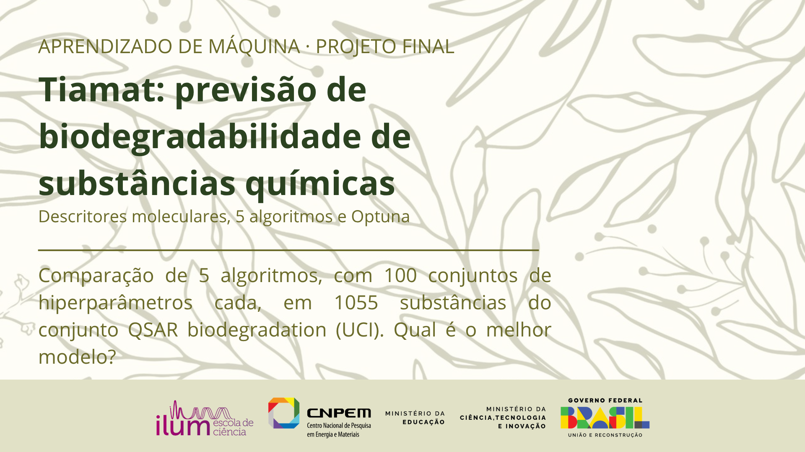

 **Aluno:** Luis Navarro Erbetta


 **Instituição:** Ilum Escola de Ciência - CNPEM


 **Disciplina:** Aprendizado de Máquina


 **Professor:**  Daniel Roberto Cassar- Doutor em Ciência e Engenharia de Materiais pela Universidade Federal de São Carlos (2014)


**Linguagem:** Python

## Resumo
Substâncias químicas lançadas no ambiente podem persistir ou ser degradadas rapidamente. Este projeto usa aprendizado de máquina para prever, a partir de 41 descritores moleculares, se uma substância é rapidamente biodegradável (RB) ou não (NRB). Os dados são experimentais: 1055 substâncias do conjunto *QSAR biodegradation* (UCI Machine Learning Repository).

Foram comparados 5 algoritmos (k-NN, regressão logística, SVM, Naive Bayes e floresta aleatória) contra um baseline. Cada algoritmo teve 100 conjuntos de hiperparâmetros avaliados com o [Optuna](https://optuna.org). O próprio Optuna também decidiu se aplicava redução de dimensionalidade ou seleção de atributos (limiar de variância, PCA ou RFE).

---

## Sumário

- [Pergunta do projeto](#pergunta-do-projeto)
- [Resultados](#resultados)
- [Dados](#dados)
- [Metodologia](#metodologia)
- [Estrutura do repositório](#estrutura-do-repositório)
- [Como executar](#como-executar)
- [Estrutura do notebook](#estrutura-do-notebook)
- [Limitações](#limitações)
- [Uso de IA](#uso-de-ia)
- [Referências principais](#referências-principais)

---

## Pergunta do projeto

É possível prever, a partir de 41 descritores moleculares, se uma substância é RB ou NRB? Quais algoritmos fazem isso melhor? Quais descritores mais influenciam a decisão?

## Resultados

**Resposta curta:** sim, é possível. O melhor modelo, um **SVM com kernel RBF**, obteve **MCC = 0,662** (IC 95% de 0,555 a 0,756) e acurácia de 84,7% no conjunto de teste, contra MCC = 0 e acurácia de 70,7% do baseline que sempre prevê a classe mais frequente.

| Algoritmo | MCC na CV repetida (treino) | MCC no teste |
|---|---|---|
| **SVM (campeão)** | 0,739 ± 0,052 | **0,662** (IC 95%: 0,555 a 0,756) |
| Floresta aleatória | 0,715 ± 0,048 | 0,644 |
| k-NN | 0,696 ± 0,052 | 0,641 |
| Regressão logística | 0,695 ± 0,057 | 0,656 |
| Naive Bayes | 0,564 ± 0,036 | 0,533 |
| Baseline (classe mais frequente) | 0,000 | 0,000 |

A CV repetida consiste em 5 repetições de validação cruzada com 5 partições (25 valores por algoritmo), usando apenas dados de treino. O teste foi usado uma única vez, depois da escolha do campeão.

**Principais conclusões**

- **Quatro modelos ficam praticamente empatados no topo** (SVM, regressão logística, floresta aleatória e k-NN, com MCC de teste entre 0,64 e 0,66). Os intervalos de confiança se sobrepõem quase totalmente, então as diferenças estão dentro do ruído de um teste com 215 substâncias.
- **O Naive Bayes é claramente o pior** (MCC 0,533), com revocação alta de RB (0,921) e precisão baixa (0,532). Isso é coerente com a forte correlação entre descritores, que viola a hipótese de independência condicional.
- **Redução de dimensionalidade teve impacto limitado.** O SVM campeão não usa nenhuma redução.
- **O descritor `nN` (número de átomos de nitrogênio)** é o resultado mais robusto da interpretação: é o primeiro tanto na *permutation importance* quanto no SHAP.
- **Todos os modelos pioraram um pouco no teste** em relação à CV repetida (de 0,031 no Naive Bayes a 0,077 no SVM), o que é esperado após a seleção do melhor entre muitas tentativas.

**Desempenho do SVM no teste (215 substâncias)**

| MCC | Acurácia | Acurácia balanceada | F1 (RB) | Precisão (RB) | Revocação (RB) | AUC-ROC | AUC-PR |
|---|---|---|---|---|---|---|---|
| 0,662 | 0,847 | 0,850 | 0,766 | 0,692 | 0,857 | 0,920 | 0,817 |

**Melhor configuração do SVM:** kernel `rbf`, `C` ≈ 4,85, `gamma` ≈ 0,044, normalização padrão, pesos de classe balanceados e nenhuma redução de dimensionalidade.

## Dados

- **Conjunto:** [QSAR biodegradation](https://archive.ics.uci.edu/dataset/254/qsar+biodegradation), UCI Machine Learning Repository (licença CC BY 4.0).
- **Origem:** dados experimentais organizados pelo *Milano Chemometrics and QSAR Research Group* a partir de resultados do NITE (Japão) [1].
- **Tamanho:** 1055 substâncias, 41 descritores numéricos e um alvo binário (356 RB e 699 NRB).
- **Arquivo esperado:** `dados/biodeg.csv`, no formato original do UCI (separador `;`, sem cabeçalho, última coluna com o rótulo `RB` ou `NRB`).

## Metodologia

1. **Divisão sem vazamento.** Substâncias quase redundantes (mesmos valores de descritores após arredondamento) são agrupadas, e a divisão treino/teste (80/20) usa `StratifiedGroupKFold`, de modo que nenhum grupo fique dos dois lados. Uma checagem por distâncias mínimas e teste de Mann-Whitney compara o split agrupado com um split aleatório.
2. **Análise exploratória apenas no treino:** qualidade dos dados, esparsidade, correlações com o alvo e entre descritores, e PCA.
3. **Métrica principal: MCC** (Coeficiente de Correlação de Matthews), por ser informativa com classes desbalanceadas, ao contrário da acurácia (um modelo que sempre prevê NRB acerta 65% no treino e 71% no teste).
4. **Pipelines.** Normalização, redução/seleção de atributos (limiar de variância, PCA ou RFE) e algoritmo ficam dentro de um `Pipeline` do scikit-learn, evitando vazamento por pré-processamento.
5. **Otimização com Optuna (TPE).** 100 tentativas por algoritmo (k-NN, regressão logística, SVM, Naive Bayes e floresta aleatória), avaliadas por validação cruzada estratificada e agrupada com as mesmas partições. O próprio Optuna decide se aplica redução de dimensionalidade.
6. **Comparação.** Validação cruzada repetida em partições novas (5 × 5) e comparação pareada com o campeão, apenas com dados de treino, para mitigar o viés de seleção.
7. **Avaliação final.** Uso único do conjunto de teste, com oito métricas e intervalo de confiança de 95% do MCC por *bootstrap* (2000 reamostragens).
8. **Interpretação do campeão.** *Permutation importance* (30 repetições) e valores SHAP (explicador por permutações), sempre em termos dos 41 descritores originais.

## Estrutura do repositório

```
.
├── Tiamat.ipynb               # notebook principal
├── dados/
│   └── biodeg.csv             # conjunto de dados (baixar do UCI)
├── estudos_optuna/            # bancos SQLite dos estudos (gerados pelo notebook)
├── figuras/                   # gráficos em PNG (gerados pelo notebook)
├── resultados/
│   ├── melhores_hiperparametros.json
│   ├── comparacao_cv_repetida.csv
│   └── avaliacao_teste.csv
└── README.md
```

As pastas `estudos_optuna/`, `figuras/` e `resultados/` são criadas automaticamente na primeira execução.

## Como executar

O notebook foi desenvolvido em **Python 3.13.7**.

**1. Clone o repositório e crie um ambiente virtual**

```bash
git clone <https://archive.ics.uci.edu/dataset/254/qsar+biodegradation>
cd <Tiamat--LuisT26>
python -m venv .venv
source .venv/bin/activate        # Windows: .venv\Scripts\activate
```

**2. Instale as dependências**

```bash
pip install numpy pandas matplotlib seaborn scipy scikit-learn optuna shap jupyter
```

**3. Baixe os dados** da [página do UCI](https://archive.ics.uci.edu/dataset/254/qsar+biodegradation) e coloque o arquivo em `dados/biodeg.csv`.

**4. Abra e execute o notebook**

```bash
jupyter notebook Tiamat.ipynb
```

Para reproduzir exatamente os resultados, execute todas as células em ordem (*Run All*). Todas as sementes aleatórias são fixas (`SEMENTE_ALEATORIA = 61455`, e a CV repetida usa `[11, 22, 33, 44, 55]`).

> **Sobre os estudos do Optuna:** eles ficam salvos em `estudos_optuna/`, então rodar o notebook novamente reaproveita as buscas já feitas. Para refazer a otimização do zero, apague essa pasta.
>
> **Sobre versões:** pequenas diferenças numéricas podem aparecer se as versões das bibliotecas (principalmente scikit-learn, Optuna e SHAP) forem diferentes das usadas no desenvolvimento. Para reprodução fiel, congele as versões do seu ambiente com `pip freeze > requirements.txt`.

## Estrutura do notebook

| Seção | Conteúdo |
|:-:|---|
| 1 | Introdução |
| 2 | Configuração (imports, constantes, funções auxiliares) |
| 3 | Os dados (origem, carregamento e descritores) |
| 4 | Divisão em treino e teste sem vazamento, baseline e checagem do split |
| 5 | Análise exploratória (apenas treino) |
| 6 | Métrica de desempenho (MCC) e baseline |
| 7 | Estratégia experimental (pipelines, validação cruzada e função objetivo) |
| 8 | Otimização de hiperparâmetros com Optuna |
| 9 | Comparação dos algoritmos (CV repetida) |
| 10 | Avaliação final no conjunto de teste |
| 11 | Interpretação do campeão (*permutation importance* e SHAP) |
| 12 | Conclusões e principais aprendizados |
| 13 | Lore da disciplina |

## Limitações

- O teste tem apenas 215 substâncias e uma proporção de RB (29,3%) menor que a do treino (34,9%), então os intervalos de confiança são largos.
- O agrupamento por arredondamento é uma proteção **parcial** contra quase-duplicatas: valores muito próximos podem cair em inteiros diferentes. A checagem de distâncias não mostrou o teste mais longe do treino no split agrupado (p = 0,293).
- O melhor MCC do Optuna é o máximo de 100 tentativas e tende a ser otimista. A CV repetida mitiga, mas não elimina, esse viés (a validação cruzada aninhada seria o passo seguinte).
- O SVM usado não fornece probabilidades calibradas, e as explicações (*permutation importance* e SHAP) descrevem o que o modelo aprendeu, **não relações causais** químicas.
- A *permutation importance* e o SHAP discordam parcialmente (correlação de Spearman entre os rankings de 0,31, com 5 descritores em comum entre os dez primeiros), em parte pela correlação e esparsidade dos descritores.

## Uso de IA

Foi usada a IA Claude (Anthropic), via interface de chat, para auxiliar na escolha do conjunto de dados, na coletânea de referências, na construção e correção de células de código, na discussão de pontos teóricos, na sugestão de próximos passos e na revisão final do notebook.

## Referências principais

1. MANSOURI, K. et al. Quantitative Structure-Activity Relationship models for ready biodegradability of chemicals. *Journal of Chemical Information and Modeling*, v. 53, n. 4, p. 867-878, 2013. Dados: [UCI Machine Learning Repository](https://archive.ics.uci.edu/dataset/254/qsar+biodegradation) (CC BY 4.0).
2. CHICCO, D.; JURMAN, G. The advantages of the Matthews correlation coefficient (MCC) over F1 score and accuracy in binary classification evaluation. *BMC Genomics*, v. 21, art. 6, 2020.
3. AKIBA, T. et al. Optuna: a next-generation hyperparameter optimization framework. *KDD*, 2019.
4. BERGSTRA, J. et al. Algorithms for hyper-parameter optimization. *NIPS*, 2011.
5. PEDREGOSA, F. et al. Scikit-learn: machine learning in Python. *JMLR*, v. 12, p. 2825-2830, 2011.
6. LUNDBERG, S. M.; LEE, S.-I. A unified approach to interpreting model predictions. *NIPS*, 2017.
7. KAUFMAN, S. et al. Leakage in data mining: formulation, detection, and avoidance. *ACM TKDD*, v. 6, n. 4, 2012.
8. VARMA, S.; SIMON, R. Bias in error estimation when using cross-validation for model selection. *BMC Bioinformatics*, v. 7, art. 91, 2006.

A lista completa de referências está na última seção do notebook.
