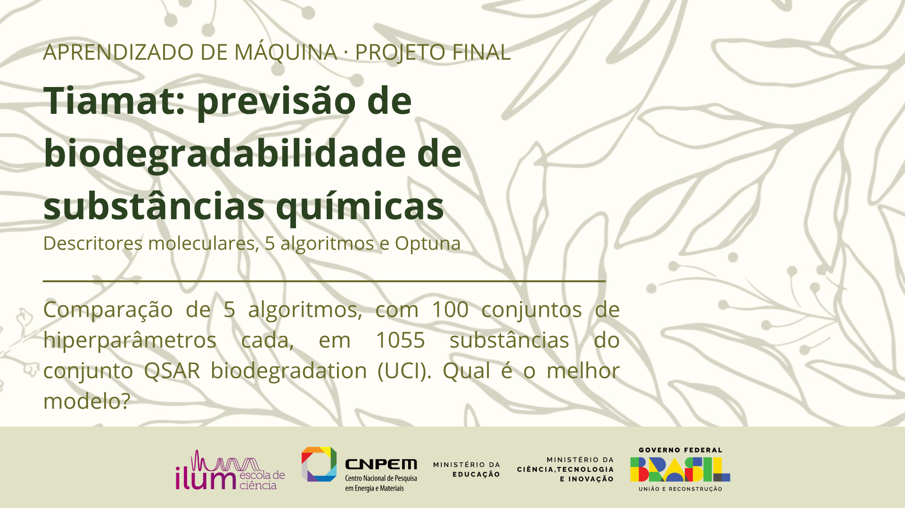

 **Aluno:** Luis Navarro Erbetta

 **Instituição:** Ilum Escola de Ciência - CNPEM

 **Disciplina:** Aprendizado de Máquina

 **Professor:**  Daniel Roberto Cassar- Doutor em Ciência e Engenharia de Materiais pela Universidade Federal de São Carlos (2014)

**Linguagem:** Python

## Resumo
Substâncias químicas lançadas no ambiente podem persistir ou ser degradadas rapidamente por microrganismos. Este projeto usa aprendizado de máquina para prever, a partir de 41 descritores moleculares, se uma substância é rapidamente biodegradável (RB) ou não (NRB). Os dados são experimentais: 1055 substâncias do conjunto *QSAR biodegradation* (UCI Machine Learning Repository).

Foram comparados 5 algoritmos (k-NN, regressão logística, SVM, Naive Bayes e floresta aleatória) contra um baseline. Cada algoritmo teve 100 conjuntos de hiperparâmetros avaliados com o [Optuna](https://optuna.org). O próprio Optuna também decidiu se aplicava redução de dimensionalidade ou seleção de atributos (limiar de variância, PCA ou RFE).

